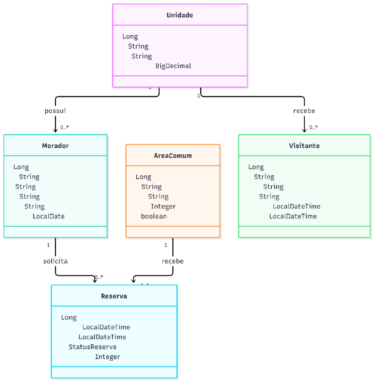
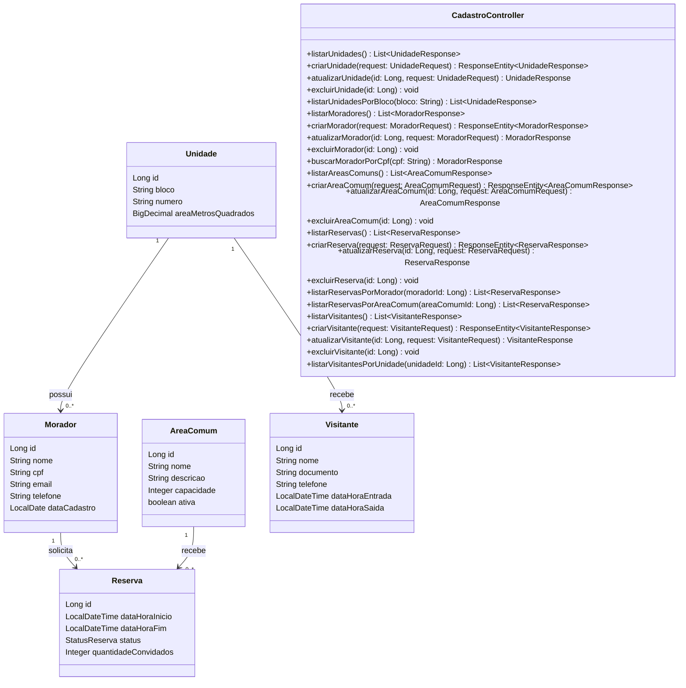

# 1. Visão Geral do Projeto

## Identificação da Equipe e Submissão

- **Líder:** Cleberson
- **Integrantes:** Marceu, Diego, Thiago, Jeliel e Alisson
- **Repositório Git:** [SmartCondo no GitHub](https://github.com/maia202/smartcondo)
- **Aplicação publicada:** [https://smartcondo-od8l.onrender.com/](https://smartcondo-od8l.onrender.com/)

## 1.1 Nome do Produto

SmartCondo

## 1.2 Declaração do Problema e Justificativa

A gestão condominial realizada por planilhas, formulários em papel e mensagens dispersas dificulta a atualização dos cadastros, o controle de visitantes e a organização das reservas de áreas comuns. Esse processo pode gerar informações duplicadas, conflitos de agendamento e demora para localizar registros.

O SmartCondo propõe centralizar esses dados em uma aplicação com persistência relacional e API REST. A automação dá suporte ao controle de unidades e moradores, ao registro de visitantes e à consulta e organização de reservas, tornando as informações mais consistentes e acessíveis aos responsáveis.

## 1.3 Público-Alvo e Objetivos do Sistema

O público-alvo inclui:

- **Moradores:** manter seus dados cadastrais e solicitar ou consultar reservas.
- **Síndico e administração:** organizar cadastros, áreas comuns e reservas.
- **Portaria:** consultar unidades e registrar entradas e saídas de visitantes.

O objetivo é fornecer uma base centralizada para a gestão das informações essenciais do condomínio, com regras de persistência relacionais e operações REST para os cadastros.

# 2. Especificação de Requisitos

## 2.1 Requisitos Funcionais

- **RF01 - Autenticação de usuários:** permitir que usuários autorizados acessem o sistema de acordo com seu perfil. A autenticação será implementada em etapa posterior.
- **RF02 - Cadastro de unidades:** cadastrar, consultar, atualizar e remover unidades, identificadas por bloco e número.
- **RF03 - Cadastro de moradores:** manter nome, CPF, contato e unidade vinculada a cada morador.
- **RF04 - Cadastro de áreas comuns:** manter nome, descrição, capacidade e disponibilidade das áreas comuns.
- **RF05 - Agendamento de áreas comuns:** registrar reservas vinculadas a um morador e a uma área comum, com período e situação.
- **RF06 - Controle de visitantes:** registrar visitantes, documento, unidade de destino e horários de entrada e saída.
- **RF07 - Consulta de informações:** permitir consultar moradores por CPF (`GET /api/moradores/cpf/{cpf}`), unidades por bloco (`GET /api/unidades/bloco/{bloco}`), reservas por morador ou área comum (`GET /api/reservas/morador/{moradorId}` e `GET /api/reservas/area-comum/{areaComumId}`) e visitantes por unidade (`GET /api/visitantes/unidade/{unidadeId}`).

## 2.2 Requisitos Não Funcionais

- **RNF01 - Segurança:** dados pessoais, incluindo CPF e documento de visitante, devem ter acesso restrito por autenticação e autorização antes da disponibilização em ambiente de produção.
- **RNF02 - Desempenho:** consultas comuns de cadastro devem responder em até 2 segundos sob carga normal de uso, a ser validado em testes.
- **RNF03 - Banco de dados:** utilizar banco relacional e persistência por Spring Data JPA. O perfil local usa H2 em memória; PostgreSQL pode ser configurado para persistência externa.
- **RNF04 - API REST:** os recursos devem seguir convenções REST, utilizar métodos HTTP adequados e retornar códigos de status coerentes. A API está implementada com operações CRUD e consultas por filtros.
- **RNF05 - Validação:** validar campos obrigatórios e formatos de entrada com Bean Validation.
- **RNF06 - Portabilidade:** executar em Java 17 ou superior e empacotar a aplicação com Maven e Spring Boot.
- **RNF07 - Integridade:** chaves estrangeiras devem manter as relações entre moradores, unidades, reservas, áreas comuns e visitantes; CPF e identificação de bloco/número da unidade devem ser únicos.

# 3. Arquitetura e Modelagem de Dados

## 3.1 Diagrama de Classes UML

### Versão visual



O arquivo PlantUML editável está em [`docs/diagrams/diagrama-classes.puml`](./docs/diagrams/diagrama-classes.puml). Para renderizá-lo visualmente no VS Code, abra o arquivo `.puml` com uma extensão de PlantUML instalada.

### Versão detalhada com atributos e operações



O diagrama apresenta as operações de consulta por filtro implementadas pelo controlador; as operações CRUD também estão disponíveis para as cinco entidades.

## 3.2 Mapeamento de Entidades JPA e Dicionário de Dados

As cinco entidades persistentes ficam no pacote `br.com.smartcondo.domain.model`; seus repositórios ficam em `br.com.smartcondo.domain.repository`.

- **`@Entity` e `@Table`:** identificam as classes persistentes e nomeiam suas tabelas.
- **`@Id` e `@GeneratedValue`:** definem a chave primária e a geração automática do identificador.
- **`@ManyToOne`:** representa o lado que contém a chave estrangeira. Assim, `Morador` e `Visitante` apontam para `Unidade`, e `Reserva` aponta para `Morador` e `AreaComum`.
- **`@OneToMany(mappedBy = "...")`:** representa o lado inverso das relações. As coleções em `Unidade`, `Morador` e `AreaComum` não criam uma tabela de junção; `mappedBy` aponta para o atributo que mantém a chave estrangeira no lado `@ManyToOne`.
- **Lombok:** `@Data`, `@NoArgsConstructor` e `@AllArgsConstructor` reduzem o código repetitivo. As associações são excluídas de `toString`, `equals` e `hashCode` para evitar recursão entre entidades relacionadas.
- **`@Enumerated(EnumType.STRING)`:** grava a situação da reserva pelo nome do valor (`PENDENTE`, `CONFIRMADA` ou `CANCELADA`), não por ordinal.

| Entidade / tabela | Atributos principais | Relacionamentos e restrições |
|---|---|---|
| `Unidade` / `unidades` | `id` (Long), `bloco` (String), `numero` (String), `areaMetrosQuadrados` (BigDecimal) | Bloco e número são únicos em conjunto; relaciona-se com moradores e visitantes. |
| `Morador` / `moradores` | `id` (Long), `nome` (String), `cpf` (String), `email` (String), `telefone` (String), `dataCadastro` (LocalDate) | CPF único; contém a FK `unidade_id`; pode possuir reservas. |
| `AreaComum` / `areas_comuns` | `id` (Long), `nome` (String), `descricao` (String), `capacidade` (Integer), `ativa` (boolean) | Pode receber várias reservas. |
| `Reserva` / `reservas` | `id` (Long), `dataHoraInicio` (LocalDateTime), `dataHoraFim` (LocalDateTime), `status` (StatusReserva), `quantidadeConvidados` (Integer) | Contém as FKs `morador_id` e `area_comum_id`. |
| `Visitante` / `visitantes` | `id` (Long), `nome` (String), `documento` (String), `telefone` (String), `dataHoraEntrada` (LocalDateTime), `dataHoraSaida` (LocalDateTime) | Contém a FK `unidade_id`. |

**Como executar após clonar o projeto**

É necessário ter Git e Java 17 ou superior instalados. Não é necessário instalar Maven nem Node.js para executar o sistema: o Maven Wrapper incluído no repositório cuida do Maven, e o painel web é servido pela aplicação Spring Boot. Na primeira execução, é necessária uma conexão com a internet para baixar o Maven e as dependências Java.

1. Clone o repositório e entre na pasta do projeto:

   ```bash
   git clone https://github.com/maia202/smartcondo.git
   cd smartcondo
   ```

2. Confira se o Java está disponível:

   ```bash
   java -version
   ```

   A versão exibida deve ser 17 ou superior. Se o comando não for encontrado, instale um JDK 17+ e abra um novo terminal.

3. Inicie a aplicação com o Maven Wrapper:

   **Windows (PowerShell):**

   ```powershell
   .\mvnw.cmd spring-boot:run
   ```

   **Linux/macOS (terminal):**

   ```bash
   ./mvnw spring-boot:run
   ```

4. Aguarde a mensagem `Started SmartCondoApplication` no terminal e abra [http://localhost:8081/](http://localhost:8081/) no navegador. Mantenha o terminal aberto enquanto estiver usando o sistema; para encerrar, pressione `Ctrl+C`.

Se a porta 8081 já estiver ocupada, escolha outra antes de iniciar:

**Windows (PowerShell):**

```powershell
$env:SERVER_PORT = "8082"
.\mvnw.cmd spring-boot:run
```

**Linux/macOS:**

```bash
SERVER_PORT=8082 ./mvnw spring-boot:run
```

Nesse caso, acesse [http://localhost:8082/](http://localhost:8082/).

O backend usa Java 17, Spring Boot, Spring Data JPA e H2 em memória. Opcionalmente, com Node.js instalado, `npm start` inicia a mesma aplicação pelo Maven Wrapper; Node.js não substitui o Java.

A aplicação inicia na porta 8081. A rota `/` apresenta o painel web responsivo do SmartCondo. Os indicadores do resumo são carregados pela API `/api/dashboard`, e `/api/status` informa a disponibilidade do serviço. O console H2 fica disponível em `/h2-console` enquanto a aplicação estiver em execução. Como o banco está em memória, os dados são descartados ao encerrar a aplicação.

**Publicação no Render**

O arquivo `render.yaml` define um Blueprint com o serviço Docker do Spring Boot e um PostgreSQL gerenciado. Para publicar:

1. Envie as alterações deste projeto para o repositório GitHub.
2. No Render, crie um **Blueprint** e conecte o repositório que contém este projeto.
3. Revise os recursos detectados e aplique o Blueprint. O Render criará o serviço web e o banco; as credenciais são vinculadas automaticamente, sem incluí-las no repositório.
4. Quando o deploy terminar, abra a URL pública do serviço. A rota `/api/status` deve responder com status `online`.

No Render, o perfil `render` usa PostgreSQL e desativa o console H2. Localmente, o perfil padrão continua usando H2 em memória. O plano gratuito pode suspender o serviço web quando estiver inativo e o PostgreSQL gratuito tem limitações de disponibilidade e retenção; confira as condições e prazos vigentes no Render antes de depender dele para guardar dados. Como a aplicação ainda não possui autenticação, use apenas dados fictícios na URL pública.

**Cadastros REST disponíveis**

O painel permite cadastrar, listar, editar e excluir as cinco entidades. No cadastro de moradores, selecione bloco e apartamento diretamente; se a unidade ainda não existir, o sistema a cria automaticamente antes de vincular o morador. Na reserva, o morador responsável e o espaço comum são selecionados em listas de cadastros existentes. O espaço comum é o local físico (por exemplo, salão de festas ou churrasqueira); a reserva é o agendamento desse espaço para um período. Cadastre esses espaços no módulo Áreas comuns antes de criar reservas.

| Recurso | Endpoint | Relações recebidas |
|---|---|---|
| Unidades | `/api/unidades` | Blocos de 1 a 14; apartamentos 11, 12, 13, 14, 21, 22, 23, 24, 31, 32, 33, 34, 41, 42, 43 e 44 |
| Moradores | `/api/moradores` | `unidadeId` |
| Áreas comuns | `/api/areas-comuns` | — |
| Reservas | `/api/reservas` | `moradorId`, `areaComumId` |
| Visitantes | `/api/visitantes` | `unidadeId` |

Além da listagem, cada recurso aceita `POST` para cadastrar, `PUT /{id}` para atualizar e `DELETE /{id}` para excluir. As consultas específicas do RF07 são:

| Consulta | Endpoint |
|---|---|
| Morador por CPF | `GET /api/moradores/cpf/{cpf}` |
| Unidades por bloco | `GET /api/unidades/bloco/{bloco}` |
| Reservas por morador | `GET /api/reservas/morador/{moradorId}` |
| Reservas por área comum | `GET /api/reservas/area-comum/{areaComumId}` |
| Visitantes por unidade | `GET /api/visitantes/unidade/{unidadeId}` |

Os cadastros retornam HTTP 201, validações inválidas retornam HTTP 400 e conflitos de CPF/unidade retornam HTTP 409. CPFs inexistentes e IDs inexistentes enviados a operações de atualização ou exclusão retornam HTTP 404; consultas filtradas por IDs sem resultados retornam uma lista vazia. Registros relacionados não podem ser removidos enquanto houver dependências.

Esta etapa entrega a aplicação Spring Boot, o modelo JPA, os repositórios, o painel visual com indicadores conectados ao banco e operações CRUD e consultas por filtros para os cinco cadastros. A autenticação de usuários ainda não está implementada; por isso, a aplicação não deve ser publicada com dados pessoais reais sem controles de acesso.

Para executar os testes de persistência:

```powershell
.\mvnw.cmd test
```

Em Linux ou macOS, use `./mvnw test`.
