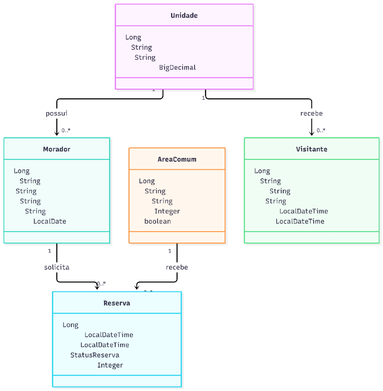

# 1. Visão Geral do Projeto

## Identificação da Equipe e Submissão

- **Líder:** Cleberson
- **Integrantes:** Marceu, Diego, Thiago, Jeliel e Alisson
- **Repositório Git:** [SmartCondo no GitHub](https://github.com/maia202/smartcondo)
- **Aplicação publicada:** [https://smartcondo-53uf.onrender.com/](https://smartcondo-53uf.onrender.com/)
- **Documentação da API (Swagger):** [https://smartcondo-53uf.onrender.com/swagger-ui/index.html](https://smartcondo-53uf.onrender.com/swagger-ui/index.html)

## 1.1 Nome do Produto

SmartCondo

## 1.2 Declaração do Problema e Justificativa

A gestão condominial realizada por planilhas, formulários em papel e mensagens dispersas dificulta a atualização dos cadastros, o controle de visitantes e a organização das reservas de áreas comuns. Esse processo pode gerar informações duplicadas, conflitos de agendamento e demora para localizar registros.

O SmartCondo propõe centralizar esses dados em uma aplicação com persistência relacional e API REST. A automação dá suporte ao controle de unidades e moradores, ao registro de visitantes e à consulta e organização de reservas, tornando as informações mais consistentes e acessíveis aos responsáveis.

## 1.3 Público-Alvo e Objetivos do Sistema

O público-alvo inclui:

- **Moradores:** manter seus dados cadastrais e solicitar ou consultar reservas.
- **Síndico e administração:** organizar cadastros, áreas comuns e reservas.
- **Portaria:** consultar unidades e registrar entradas e saídas de visitantes.

O objetivo é fornecer uma base centralizada para a gestão das informações essenciais do condomínio, com regras de persistência relacionais e operações REST para os cadastros.

# 2. Especificação de Requisitos

## 2.1 Requisitos Funcionais

- **RF01 - Autenticação de usuários:** permitir que usuários autorizados acessem o sistema de acordo com seu perfil. A autenticação será implementada em etapa posterior.
- **RF02 - Cadastro de unidades:** cadastrar, consultar, atualizar e remover unidades, identificadas por bloco e número.
- **RF03 - Cadastro de moradores:** manter nome, CPF, contato e unidade vinculada a cada morador.
- **RF04 - Cadastro de áreas comuns:** manter nome, descrição, capacidade e disponibilidade das áreas comuns.
- **RF05 - Agendamento de áreas comuns:** registrar reservas vinculadas a um morador e a uma área comum, com período e situação.
- **RF06 - Controle de visitantes:** registrar visitantes, documento, unidade de destino e horários de entrada e saída.
- **RF07 - Consulta de informações:** permitir consultar moradores por CPF (`GET /api/moradores/cpf/{cpf}`), unidades por bloco (`GET /api/unidades/bloco/{bloco}`), reservas por morador ou área comum (`GET /api/reservas/morador/{moradorId}` e `GET /api/reservas/area-comum/{areaComumId}`) e visitantes por unidade (`GET /api/visitantes/unidade/{unidadeId}`).
- **RF08 - Documentação da API:** documentação interativa via Swagger/OpenAPI 3.0 disponível em `/swagger-ui/index.html`.

## 2.2 Requisitos Não Funcionais

- **RNF01 - Segurança:** dados pessoais, incluindo CPF e documento de visitante, devem ter acesso restrito por autenticação e autorização antes da disponibilização em ambiente de produção.
- **RNF02 - Desempenho:** consultas comuns de cadastro devem responder em até 2 segundos sob carga normal de uso, a ser validado em testes.
- **RNF03 - Banco de dados:** utilizar banco relacional e persistência por Spring Data JPA. O perfil local usa H2 em memória; PostgreSQL pode ser configurado para persistência externa.
- **RNF04 - API REST:** os recursos devem seguir convenções REST, utilizar métodos HTTP adequados (GET, POST, PUT, DELETE) e retornar códigos de status coerentes (200, 201, 204, 400, 404).
- **RNF05 - Validação:** validar campos obrigatórios e formatos de entrada com Bean Validation (`@NotBlank`, `@NotNull`, etc.) nos DTOs.
- **RNF06 - Portabilidade:** executar em Java 17 ou superior e empacotar a aplicação com Maven e Spring Boot.
- **RNF07 - Integridade:** chaves estrangeiras devem manter as relações entre moradores, unidades, reservas, áreas comuns e visitantes; CPF e identificação de bloco/número da unidade devem ser únicos.

# 3. Arquitetura e Modelagem de Dados

## 3.1 Diagrama de Classes UML

### Versão visual



O arquivo PlantUML editável está em [`docs/diagrams/diagrama-classes.puml`](./docs/diagrams/diagrama-classes.puml). Para renderizá-lo visualmente no VS Code, abra o arquivo `.puml` com uma extensão de PlantUML instalada.

### Versão detalhada com atributos e operações

```mermaid
classDiagram
    class Unidade {
        Long id
        String bloco
        String numero
        BigDecimal areaMetrosQuadrados
    }
    class Morador {
        Long id
        String nome
        String cpf
        String email
        String telefone
        LocalDate dataCadastro
    }
    class AreaComum {
        Long id
        String nome
        String descricao
        Integer capacidade
        boolean ativa
    }
    class Reserva {
        Long id
        LocalDateTime dataHoraInicio
        LocalDateTime dataHoraFim
        StatusReserva status
        Integer quantidadeConvidados
    }
    class Visitante {
        Long id
        String nome
        String documento
        String telefone
        LocalDateTime dataHoraEntrada
        LocalDateTime dataHoraSaida
    }
    class CadastroController {
        +listarUnidades() List~UnidadeResponse~
        +criarUnidade(request: UnidadeRequest) ResponseEntity~UnidadeResponse~
        +atualizarUnidade(id: Long, request: UnidadeRequest) UnidadeResponse
        +excluirUnidade(id: Long) void
        +listarUnidadesPorBloco(bloco: String) List~UnidadeResponse~
        +listarMoradores() List~MoradorResponse~
        +criarMorador(request: MoradorRequest) ResponseEntity~MoradorResponse~
        +atualizarMorador(id: Long, request: MoradorRequest) MoradorResponse
        +excluirMorador(id: Long) void
        +buscarMoradorPorCpf(cpf: String) MoradorResponse
        +listarAreasComuns() List~AreaComumResponse~
        +criarAreaComum(request: AreaComumRequest) ResponseEntity~AreaComumResponse~
        +atualizarAreaComum(id: Long, request: AreaComumRequest) AreaComumResponse
        +excluirAreaComum(id: Long) void
        +listarReservas() List~ReservaResponse~
        +criarReserva(request: ReservaRequest) ResponseEntity~ReservaResponse~
        +atualizarReserva(id: Long, request: ReservaRequest) ReservaResponse
        +excluirReserva(id: Long) void
        +listarReservasPorMorador(moradorId: Long) List~ReservaResponse~
        +listarReservasPorAreaComum(areaComumId: Long) List~ReservaResponse~
        +listarVisitantes() List~VisitanteResponse~
        +criarVisitante(request: VisitanteRequest) ResponseEntity~VisitanteResponse~
        +atualizarVisitante(id: Long, request: VisitanteRequest) VisitanteResponse
        +excluirVisitante(id: Long) void
        +listarVisitantesPorUnidade(unidadeId: Long) List~VisitanteResponse~
    }

    Unidade "1" --> "0..*" Morador : possui
    Unidade "1" --> "0..*" Visitante : recebe
    Morador "1" --> "0..*" Reserva : solicita
    AreaComum "1" --> "0..*" Reserva : recebe